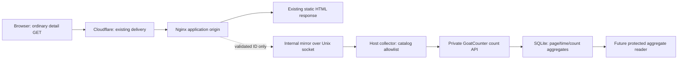

# ADR: automatic origin request counts for GoatCounter

**Status:** owner selected the origin-request direction on 2026-10-29; the
implementation below is proposed source design, not deployed or legally cleared.
**Issue:** #376. **Baseline:** coloring-pages main
`a0c40232cc32eb8880868bd6bd5368fdf4491829`.

## Decision and scope

Count eligible detail-page HTTP requests received at the application origin.
Do not activate the new browser `POST /api/pageview` client from #391, load
GoatCounter count.js, add a pixel, or publish the planned pageview tunnel route.
The owner explicitly chose this changed metric rather than rendered-page events.

Reuse the private GoatCounter v2.7.0 backend and count-only credential. Introduce
an internal Nginx mirror target connected to a Unix-domain socket served by the
existing host-side collector. Do not route ordinary page delivery through a new
analytics proxy or expose the collector on the Docker bridge/public network.
Keep the current rendering, printing and cache behavior.

This supersedes the browser-emission and public-collection-route portions of
`GOATCOUNTER_RPI5_DESIGN_376.md`. Its historical privacy findings still apply
where relevant. #391 is a superseded browser candidate and must not be merged.
RPi5_main #1271's unused public-route operator is no longer this rollout's path.

## Metric contract

The metric is **counted eligible origin detail requests**, not people, sessions,
all browser opens, successful renders or prints. Proposed German label:
**Gezählte Vorlagenanfragen am Ursprungsserver**.

An eligible request has all of these properties:

- Exact normalized `/detail.html` path and original HTTP method GET.
- Exactly one literal, case-sensitive `id` query key, containing exactly seven
  ASCII digits. Preserve leading zeroes. Other well-formed query parameters may
  be present but are discarded; no campaign/referrer value reaches the collector.
- Reject ambiguous/malformed query shapes, duplicate id keys and encoded key
  aliases rather than guessing which value the frontend would use. Bound the
  query length for measurement only; ineligible measurement must not block HTML.
- The collector independently confirms the ID is a currently visible/renderable
  catalog entry. Malformed/unavailable catalog means drop measurement.
- One internal submission attempt per eligible original request; no mirror
  recursion, secondary collector, retry queue or resend after ambiguity.

Use the distinct logical path `/origin-detail-request/<id>` in GoatCounter so
future reporting cannot silently combine this metric with the old proposed
`/coloring-page/<id>` browser event. No extra analytics dimensions are added.
GoatCounter receives only `no_sessions:true` and a path-only hit. Keep collect=1
and the configured native data_retention=365.

Mirror runs before the final response is known. This version therefore does not
claim to count only 2xx responses: an eligible request can count even if HTML
delivery later fails. HEAD, POST, health checks, assets, print pages, unrelated
routes and invalid/unpublished IDs do not count. Reloads, conditional GETs,
prefetchers, bots and deliberate repeated requests can count independently.
Do not inspect User-Agent/IP to manufacture unique users or bot accuracy.

Responses served entirely by browser/CDN cache do not reach the origin and are
not counted. Connection failures or collector saturation can undercount; no
lossless/exactly-once claim is made. Do not disable caching to make counts larger.
The source currently uses `no-cache` for HTML, which requests revalidation, not
absence of storage. Actual edge overrides remain a future scoped observation.

Reports use Europe/Berlin calendar dates for today/7d/30d. Replace the old
unqualified all-time label with **since activation, within retained history**.
365 days is the native age threshold with daily cleanup, not exact calendar-year
or instantaneous deletion. Unknown/unavailable/stale results must not appear as 0.

## Data flow and ownership

| Boundary | Allowed data and responsibility |
| --- | --- |
| Browser/Cloudflare/origin | Normal delivery still processes network metadata and the original URL. No new browser analytics request. Existing logs require their own review. |
| Nginx mirror | Construct a new bounded JSON body containing only page_id. Do not forward original headers, body, query, cookies, Authorization, UA, Referer, forwarding headers or request IDs. |
| Unix collector | Fixed internal route and method; filesystem/peer boundary plus independent body/catalog validation. A browser Origin header is not authentication for this channel. |
| GoatCounter | Existing host-held count-only token; only fixed logical path, no_sessions and aggregation. No credential mounted into the app container. |
| Protected reader | Aggregates only; current catalog provides titles/categories. No event rows or public admin listener. |

coloring-pages owns Nginx/Compose source, request eligibility and ADMIN display.
RPi5_main owns the collector/socket service, host permissions, runtime wiring and
GoatCounter credential/backend. Both repositories require reviewed source before
the corresponding exact-authorized runtime change.

## Internal transport design

Proposed socket: `/run/ausmalwiese-pageview/origin.sock`. Bind-mount its dedicated
directory read-only into the application container at the same path. Mount the
directory, not the socket inode, so collector restarts can recreate the socket.
Never mount the database, credential root, Docker socket or broad host trees.

Use a dedicated existing collector group and explicit supplementary container
group, resolved from authorized host metadata; no invented UID/GID or chmod 777.
Dockerfile currently declares USER 101. The real peer UID mapping, user namespaces,
socket mode/group and read-only-bind connection must be proven with an isolated
fixture and then scoped host checks. A read-only filesystem mount does not itself
make an IPC protocol read-only. The protocol intentionally permits only counts.

Add an explicit Unix listener mode to the collector, separate from its old
browser-origin HTTP contract. Prefer replacing its unused TCP 9193 listener in
the final cutover. Keep GoatCounter 9194 loopback-only. Do not treat a forged Host
or Origin header as proof that a Unix message came from the application; validate
socket access and expected peer credentials where available.

Nginx requirements: an `internal` mirror location, `mirror_request_body off`,
request headers disabled, explicit fixed Host/Content-Type, newly generated body
and Content-Length, fixed upstream path with no original query, no proxy cache,
`proxy_next_upstream off`, short connect/send/read timeouts, bounded buffering and
no analytics temp-file persistence. Pin and test the actual Nginx image/module;
do not use newer documentation-only directives unavailable in the current image.

Do not copy the upstream mirror example's `$request_uri`, X-Original-URI or client
header forwarding. Implement and test the strict query eligibility maps before
committing a deployment config. Merely using `$arg_id` is insufficient for the
case/duplicate/encoded-key contract above.

Mirror responses are ignored, but that alone does not prove absence of latency
or resource coupling. Test slow/absent/malformed collector behavior and request
floods against normal HTML/print behavior. Prefer bounded drops to delivery delay;
do not persist a raw-event queue. Disable analytics-subrequest access logging and
ensure error paths cannot write raw query/headers. Retain only sanitized health
counts/error classes; ordinary origin/edge logging is a separate release fact.

## Existing Stats and historical data

Keep current Like/Print/QR/campaign behavior and data unchanged in this rollout.
The old Stats view increments daily_views and also campaign detail events. It
cannot simply be deleted without changing existing campaign reporting. Keep
those legacy figures separate from the new origin-request metric and explain
the difference; do not sum or rename old totals as GoatCounter origin requests.

This means the site still has its existing Stats JavaScript traffic. The decision
removes the planned additional GoatCounter browser measurement; it is not a claim
that every existing telemetry call has disappeared. Retirement or decomposition
of Stats view/visit requires its own scoped design and must preserve campaign
reporting or explicitly change that product behavior.

The new protected ADMIN reader/display is part of implementation completion.
The count-only token cannot read statistics: reuse neither it with broader rights
nor a browser token. Prefer a separate narrowly scoped host reader/credential and
existing ADMIN authorization, with its exact provisioning and read authority
specified in the runtime plan. Source review must select the read API and enforce
only the new path prefix before a public activation is considered complete.

## Completed private foundation

- [Installation receipt](https://github.com/rozkalnsandris/RPi5_main/pull/1269#issuecomment-6464118635):
  v2.7.0 private backend, collector and count-only credential.
- [Retention receipt](https://github.com/rozkalnsandris/RPi5_main/pull/1273#issuecomment-6490759307):
  source ecdf39a2643ff6a5b4a9c52f1d1b19aa6e07ce1d; native 365-day setting read back,
  empty analytics and active private services on 2026-10-29; no pageview POSTs.
- Public collection routes were absent in the earlier scoped tunnel/Worker checks.
  Those are dated observations; this source plan makes no new runtime claim.

## Implementation and rollout sequence

1. Source-only fixture: exact image Nginx syntax/module, strict query extraction,
   minimal mirror payload, Unix IPC identity, collector catalog validation and
   prefix mapping. Verify no original metadata in captured mock requests/logs.
2. RPi5_main source: Unix listener, socket lifecycle/group contract and bounded
   health/readiness. Preserve existing count-only backend and retention. Prepare
   one concrete rollout envelope covering socket files/permissions, collector
   service update and exact application mount/image update; no tunnel write.
3. coloring-pages source: Nginx/Compose integration, protected aggregate reader
   and truthful labels/error states. Keep #391 browser code out of the rollout.
   Prove Like/Print/QR/campaign regression behavior remains unchanged.
4. Reassess privacy for this selected flow and update legal PR #158 with actual
   purpose/basis, recipients, logging and retention facts. Server-side counting
   is not automatic legal clearance; no end-to-end anonymity claim.
5. Exact source merges, then separate owner-authorized host/deploy operation.
   Establish socket readiness before any app config attempts emission. Account
   for first real events during the app cutover; do not call a live mirror test
   a harmless read-only GET. Verify counts only with expressly authorized test
   events/observation; do not insert unexplained test data in the live totals.
6. Capture activation time and exact image/source/socket identities. Verify
   private access and display, no public collector route, service health and
   normal browsing. On failure follow only the frozen stop/recovery envelope;
   do not improvise restarts, rollbacks, cleanup or old browser activation.

Acceptance tests include GET/HEAD/POST, duplicate and encoded id keys, malformed
query encoding, leading zeroes, hidden/unknown catalog entries, CDN/browser cache
absence, conditional requests, final HTML failure, collector timeout/saturation,
socket replacement and permission denial, forged direct internal access, no
forwarded client metadata, no retry after ambiguous delivery and honest reporting.
CI cannot establish live edge policy, host permissions or German legal compliance.

## Alternatives and trade-offs

The browser client gives a closer signal of resolved detail pages, but adds the
terminal-access issue the owner chose to avoid. Origin request counts are simpler
to keep private but incomplete relative to all opens. An edge Worker would observe
more CDN-served traffic but widens routing/credential/runtime scope. A new proxy in
the main delivery path increases availability coupling. Importing ordinary raw
access logs would broaden data access and create an unwanted event-log dependency.

## Official references

- [GoatCounter backend collection](https://www.goatcounter.com/help/backend)
- [Nginx mirror and body handling](https://nginx.org/en/docs/http/ngx_http_mirror_module.html)
- [Nginx proxy controls and Unix sockets](https://nginx.org/en/docs/http/ngx_http_proxy_module.html)
- [Docker bind mounts and read-only mode](https://docs.docker.com/engine/storage/bind-mounts/)
- [Cloudflare cache versus origin requests](https://developers.cloudflare.com/cache/performance-review/cache-analytics/)
- [Cloudflare cache-control semantics](https://developers.cloudflare.com/cache/concepts/cache-control/)

No merge, service/permission/database/credential changes, socket creation,
application deployment, public tracking or runtime inspection occurs in this ADR.
