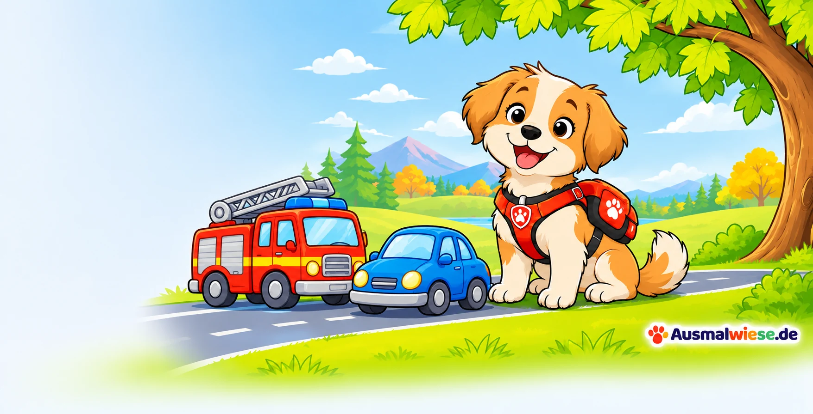

# Ausmalwiese — Topic & Category Page Hero Standard v1

**Status:** proposed, source-reviewed authoring and implementation contract (2026-11-15). **This document does not itself implement automation, publish artwork, create routes, or authorize merge/LIVE.**
**Canonical scope:** `rozkalnsandris/coloring-pages`; related umbrella [#565](https://github.com/rozkalnsandris/coloring-pages/issues/565). The initial site baseline for this contract was `main@ef021dc5eff5d9f6024a797a953d8745fd35ec09`; PR #576 subsequently updated shared image-edge blending at `main@0cf044fa67b81fb7cfbe020f5047e0715464f9e4`. Always reread current GitHub `main` before applying it.

## 1. Outcome and non-negotiable rule

Use **one reusable Page Hero system** for existing static categories, indexed editorial Topic pages, and runtime-managed Topic browse states. For the next 20+ themes, **never add a new one-off Hero component, per-category CSS override, or hand-copied image markup**. An approved new illustration is a **data + reviewed asset change**, not a new design implementation.

A newly registered, valid managed Topic must be usable **without any Hero-specific code or art change**: show the topic label/H1, breadcrumb-like browse location, filters and catalogue with **no unrelated picture**. A later approved visual adds only its manifest entry and asset, after the shared implementation is installed. This is a *target architecture*, **not** current behavior for static category image assignment.

A **browse state is not an indexed SEO landing page**. Creating a separate indexable URL is a different, evidence-based editorial and routing gate.

## 2. Baseline: the two approved references

| Reference | Current source | Contract |
| --- | --- | --- |
| **Herbst** | `herbst.html`, `assets/herbst-topic-hero.webp`, `js/topic-hero-content.js` | Real self-canonical `/herbst`, German initial HTML H1/intro, three-level breadcrumb, **six crawlable seed cards**, approved dog + pumpkin/leaves art. |
| **Fahrzeuge** | `fahrzeuge.html`, `assets/fahrzeuge-topic-hero.webp`, `css/topic-landing-hero.css` | Existing `/fahrzeuge` canonical, two-level breadcrumb, category gallery; dog + fire engine + blue car; **no excavator/bulldozer**. |
| **Current shared system** | `css/topic-landing-hero.css`, `index.html`, `js/app.js` | `.page-hero`, `.page-hero-grid`, `.page-hero-copy`, `.page-hero-art`, `.page-hero--with-art`. Topic browse hero is driven by the validated runtime Topic label, with reviewed optional art/copy from `js/topic-hero-content.js`. |

### Approved asset identities — keep immutable

- **Herbst:** native **1755 × 896 px**, WebP **119,446 bytes**, SHA-256 `d077de2efb5b291cf41140722958aa771fea6bd716da387a37458af700b0ad74`; provenance and owner decision in `docs/TOPIC_HERO_ARTWORK_567.md`; Git blob `3b935fac2d9c817ff2d0fb8f004a539c8683bbf3`.
- **Fahrzeuge:** native **1755 × 896 px**, WebP **163,810 bytes**, SHA-256 `5cf25e6cdd6a5b719f8f8c34577d3e9cba28b6b3a3c71199b24559855d9575b5`; owner approval [#573 comment](https://github.com/rozkalnsandris/coloring-pages/issues/573#issuecomment-6885565931), merged [PR #574](https://github.com/rozkalnsandris/coloring-pages/pull/574); Git blob `132fc28aceac5f2c5808e8ee2d524432863ad7a3`.

**These are two approved exemplars, not a license to reuse Herbst artwork for unrelated subjects.** The same dog identity, brand placement and visual language must remain recognizable across approved scenes.

## 3. Artwork production specification

**Canonical Hero art master: 1755 × 896 px, landscape, aspect ratio 1755:896 (~1.959:1).** This is the owner-approved project consistency target, not an A4 print format. Author one real master at those pixels; do not claim that a resize adds detail. Preserve the master and all provenance evidence outside protected print-original storage.

Art direction for every new Topic/category:
1. Keep the **same brown-and-white Ausmalwiese dog**, face, markings, proportions, red harness/backpack and friendly clean vector-like/cartoon shading **by matching the owner's approved Herbst reference**. Do not invent another generic dog. Keep the small **`Ausmalwiese.de`** logo visibly intact at the lower-right, never as a substitute for page text.
2. Change **only the subject/props/environment** to match the new category. Example: Herbst → pumpkins/leaves; Fahrzeuge → fire engine and blue car, not a bulldozer. No watermarks, unrelated motifs, random extra vehicles, third-party characters or protected trademarks.
3. Compose for **text-left / art-right on desktop**: an airy softly blended left edge, major dog and topic elements on right/central part, no critical content outside the safe composition. The complete dog, meaningful props and small logo must survive full-image `object-fit: contain` at all supported viewports. Do not crop to improve apparent art size unless an *additional, explicitly approved* mobile crop exists.
4. Image itself has **no H1, body copy, CTA, fake listing counts or embedded SEO keywords**. Header copy remains real HTML. Brand logo within approved art is an intentional exception.
5. No sharp rectangular sky/ground seam on left, top, right **or bottom**. Test the artwork against the actual Page Hero gradient, not only on white. Prefer preparing the picture's edges in the approved art; CSS `mask-image`/`mix-blend-mode` is fallback, not permission to erase the dog, wheels, logo or motif.
6. Record original generation/edit reference, approved reference image, owner approval, correct subject, original file dimensions/mode, SHA-256/byte count, optimized exact variant SHA-256, chosen `alt` treatment, and visual review evidence. **No approval -> no binary in GitHub.**

Preferred delivery: RGB, optimized **WebP** at exactly 1755×896; assess **AVIF** only if browser/quality testing justifies it. Aim for ~200 KB or less **when visually lossless-enough** for this art; >250 KB requests a compression/performance review, **not** destructive automatic rejection. The two existing approved exemplars remain at their verified bytes. For responsive delivery, derivatives such as 480w/960w/1280w/1755w may be produced **only from the approved master** with preserved proportions and no invisible re-composition; each emitted file gets its own hash and QA. A genuine mobile *art-direction* variant requires its own visual sign-off.

Website header assets belong in reviewed `assets/**` application source. They are **not** production coloring-page PNG originals or `PUBLISH` inputs.

## 4. Presentation dimensions — CSS pixels, not new artwork sizes

Current tested design is **mobile-first**. Follow shared Page Hero v2 tokens, consolidating exceptions in a single shared stylesheet. Values below document the **current baseline and required future acceptance**, not permission to hardcode a fixed pixel height for the whole hero:

| Viewport / condition | Layout | Display constraints |
| --- | --- | --- |
| **320–360 px** | One column, breadcrumb → H1 → intro → art | Current H1 floor 30px; image `max-height: 155px` at ≤360; no horizontal overflow or cropped mascot/logo. |
| **361–412 px** | One column, readable copy then art | Current H1 `clamp(30px, 8.8vw, 43px)`; art `max-height: 200px` at ≤720. |
| **413–720 px** | One column; natural text height | Art `max-height: 200px`, `object-fit: contain`, centered; no oversized empty image slot if no art. |
| **721–1024 px** | Two columns, left copy / right art | Existing `.page-hero--with-art` fractions **0.94fr / 1.06fr**; gap `clamp(12px, 2vw, 26px)`. Ensure H1 wraps naturally and breadcrumb starts at the same vertical reference. |
| **1025–1440 px** | Two columns, same component | Image max-height **350px**; intrinsic ratio preserved; no 3rd region, overlap or artificial fixed hero height. |
| **1441–1920 px and beyond** | Same centered shared container | Keep image maximum height and text-line limits; do not stretch artwork indefinitely or introduce unreviewed cropping. |
| **Text zoom 200%, DPR 1/2, long German labels** | Reflow rather than clipping | No text loss/overlap; if needed, allow two-column layout to collapse **based on actual available width**, not a special Topic override. |
| **Forced colors / no-JS / missing asset** | Meaningful text-first fallback | No blank reserved artwork box, no masked-away meaning; HTML SEO text/card links remain available on static indexed routes. |

**Current CSS exact baseline:** Page Hero vertical padding `clamp(18px, 2.5vw, 30px)` top and `clamp(20px, 2.8vw, 34px)` bottom; ≤720 uses **16px top/20px bottom**; desktop H1 `clamp(34px, 4.25vw, 58px)`; illustration `max-height:350px`; mobile switches at **720px**, special `max-height:155px` at **360px**. Homepage is a separate `.page-hero--home` layout, with its existing search/surprise tools and max-height **340px** art. Do **not** unify homepage controls into Topic/category views.

**Top-location invariant:** the visible `Startseite` or semantic breadcrumb **top edge** is aligned relative to the bottom of `.site-header` within **4 CSS px** at the *same viewport* on home, Herbst, categories and managed Topic browse. Text/hero heights may differ. The #573 Fahrzeuge alignment selector `.page-hero--category.page-hero--with-art .page-hero-copy { align-self: start; }` is now consolidated in shared `css/topic-landing-hero.css` (source scope #580); do not duplicate it in new categories. This does **not** yet implement manifest-driven rendering.

There must be **zero meaningful horizontal overflow** (automated allowance ≤1 CSS px for rounding), no image/header/footer overlap, no masked-off logo, no false empty image column, and no layout shift due to late image insertion. Native `width`/`height` must represent actual image dimensions and reserve aspect ratio. Preserve `object-fit:contain` for the master.


### Shipped image-edge blending: PR #576 (2026-11-15)

**Implemented in the shared CSS**, not merely planned. The source [PR #576](https://github.com/rozkalnsandris/coloring-pages/pull/576) merged exact HEAD `c4f3b269a853e9efa9b4109683bf6f4e1db9037a` as `main@0cf044fa67b81fb7cfbe020f5047e0715464f9e4`. This is a presentation-layer fix; the future registry-driven single Hero template in §5 is **still unimplemented**.

**Problem and solution:** Approved `/herbst` and `/fahrzeuge` illustrations showed a hard rectangular edge against the shared gradient. Fading only the bottom 14% in the initial #576 candidate did **not** visibly fix the right-hand boundary. The merged rule in `css/topic-landing-hero.css` feathers **left, top, right and bottom** and adds a small opaque elliptical *logo safety pocket* near the lower right. Existing approved Herbst/Fahrzeuge WebP bytes, alt, subject, H1/SEO, routes, aspect ratio and display dimensions are **unchanged**.

Exact current masking contract (other existing size/layout declarations omitted):

```css
.page-hero .page-hero-art img {
  object-fit: contain;
  mix-blend-mode: multiply;
  -webkit-mask-image:
    radial-gradient(ellipse 17% 12% at 91% 81%, #000 65%, transparent 100%),
    linear-gradient(90deg, transparent 0%, #000 12%, #000 86%, transparent 100%),
    linear-gradient(180deg, transparent 0%, #000 8%, #000 86%, transparent 100%);
  mask-image:
    radial-gradient(ellipse 17% 12% at 91% 81%, #000 65%, transparent 100%),
    linear-gradient(90deg, transparent 0%, #000 12%, #000 86%, transparent 100%),
    linear-gradient(180deg, transparent 0%, #000 8%, #000 86%, transparent 100%);
  -webkit-mask-composite: source-over, source-in;
  mask-composite: add, intersect;
}
```

The order and values are significant: horizontal opacity from **12% to 86%**, vertical opacity from **8% to 86%**, with soft transitions outside these bands; the elliptical pocket at **91% 81% / 17% × 12%** restores opacity around the approved `Ausmalwiese.de` mark. Keep the corresponding `@media (forced-colors: active)` mask-off fallback. **Do not copy these coordinates to arbitrary future artwork without checking the new logo placement.** This preset was tuned for the two approved masters, not guaranteed for differently composed images. Keep `object-fit: contain`; never mask away or crop the mascot, vehicles, autumn motifs or branding to hide seams.

**Verification and limits:** Exact-HEAD #576 CI **7/7 SUCCESS** and workflows **4/4 SUCCESS**, including the Chromium layout/no-overflow checks at **320, 360, 361, 390, 412, 540, 541, 768, 1024, 1365, 1440 CSS px**. Isolated candidate illustration/mask comparison at **390 and 1365 px** supported the right-edge change, but was **not** a full-page Opera candidate screenshot; automated layout success does **not** establish pixel-level visual acceptance. A subsequent separately authorized **read-only** RPi5 observation found revision `0cf044fa67b81fb7cfbe020f5047e0715464f9e4`, container running and `/health` + `/ready` both HTTP 200 **at the observation time**; do not infer perpetual LIVE status. Future art must be inspected on **actual desktop/mobile pages** next to the two approved examples, checking both faded sides, lower edge, logo legibility, 200% text zoom and forced-colors behavior.

**Change propagation:** #576 updated the shared stylesheet, its **SHA-256 version query in all nine consuming HTML pages**, and `tests/test_page_hero_569.py`. New shared-CSS edits must update all *actual* versioned consumers and relevant tests, never just one Topic or category. Do not generate new images or add one-off CSS for the same effect. See [CSS mask-composite (MDN)](https://developer.mozilla.org/en-US/docs/Web/CSS/mask-composite).


## 5. One registry-backed component — target architecture, NOT yet implemented

### Canonical ownership

| Concern | Authority | Implementation expectation |
| --- | --- | --- |
| Valid managed Topic IDs, labels, membership | Protected runtime `/topics.json` (`topics.v2`) and `/catalog.json` | Read-only, validate managed schema/IDs. Source `metadata/topics.json` is a **seed, not live truth**. New valid Topic immediately gets browse fallback. |
| Existing category IDs/routes | Repository category registry + actual reviewed category source/routes | Never infer new canonical page from a Topic slug. Existing `essen-natur` is a **derived** group, not a new canonical category registry ID. |
| Approved artwork + optional topic intro | **Reviewed source Hero manifest** | One item for each approved Topic/category art; no automatic images for unknown runtime IDs. |
| Indexed title/description/H1/canonical/seed cards | Real reviewed **initial HTML** on eligible static route | Avoid JavaScript-only indexed pages and unreviewed sitemap changes. |
| Layout, responsive behavior, accessibility | **One shared CSS + one reusable render/template layer** | No extra CSS files or one-off HTML markup per art addition after migration. |

### Proposed allowlisted manifest (illustrative contract only)

Implement **one** source-reviewed `metadata/landing-hero.v1.json` (or an equivalently validated ESM data file) that covers **both** category and Topic art. Keep category and Topic keys in **separate namespaces** and validate all fields at build/test time. The following is a future-format *example*, not a current file/API:

```json
{
  "schema": "rozkalns.ausmalwiese.landing-hero.v1",
  "categories": {
    "fahrzeuge": {
      "image": "/assets/fahrzeuge-topic-hero.webp",
      "width": 1755,
      "height": 896,
      "sha256": "5cf25e6cdd6a5b719f8f8c34577d3e9cba28b6b3a3c71199b24559855d9575b5",
      "alt": "Ausmalwiese-Hund neben einem Feuerwehrauto und einem blauen Auto",
      "provenance": "issue-573-approved-art",
      "approval_ref": "coloring-pages#573"
    }
  },
  "topics": {
    "herbst": {
      "image": "/assets/herbst-topic-hero.webp",
      "width": 1755,
      "height": 896,
      "sha256": "d077de2efb5b291cf41140722958aa771fea6bd716da387a37458af700b0ad74",
      "alt": "Ausmalwiese-Hund mit Kürbissen und buntem Herbstlaub",
      "intro": "Herbst-Ausmalbilder für Kinder: Entdecke Kürbisse, buntes Laub, Ernte-Motive, Laternen und weitere Ideen für gemütliche Herbsttage.",
      "provenance": "docs/TOPIC_HERO_ARTWORK_567.md",
      "approval_ref": "coloring-pages#567"
    }
  }
}
```

Rules:
- **A manifest entry never creates a new Topic ID, category, route, canonical, sitemap entry or publication approval.** It decorates **only** an already valid, visible registry entity.
- Accept only exact `/assets/` local paths from reviewed source (no `https:`, `data:`, `javascript:`, `..`, SVG/HTML from untrusted users, or external redirects). Strict schema: reject unknown keys, invalid ID, missing image, missing actual bytes, wrong dimensions/hash, duplicate ID or mismatched slug/path; bound German intro length and HTML-safe text.
- Static categories/indexable topics: use **build-time deterministic template/rendering** to write actual source-visible Hero HTML from approved manifest *without losing their existing unique head/title/H1/description/breadcrumb/gallery links*. Existing pages may first be migrated one by one, then the template becomes the only source of Hero markup. Avoid client-side-only replacement for indexable pages.
- Runtime browse-only Topics: validated `/topics.json` populates the already shared `[data-focused-topic-hero]` component; if optional art/copy is present in manifest, append it through safe DOM text and `img` attributes. Otherwise render the exact managed label and text-only layout. Unknown IDs and unavailable registry must **fail closed**, never fabricate an SEO route.
- **Browse-only approved artwork (#588):** source-manifest validation accepts an additional Topic with reviewed local WebP and provenance even when no `<slug>.html` exists. Only the trusted `/topics.json` registry may activate it in the browser. `/herbst` and every other existing indexed HTML stay strict; the bounded static art generator never silently creates or indexes a new Topic route. Adding a new real asset/approval still requires its own reviewed source PR.
- Static and dynamic renderers must apply the same classes and rendering semantics, not separate per-Topic CSS. Existing `js/topic-hero-content.js` is **Herbst-only today**; design a migration/compatibility step before removing it.
- A manifest update is **reviewed application source** and follows branch/PR/CI/merge rules. New art cannot go straight from user chat or ADMIN into the public manifest.
- A future ADMIN-controlled art registry, if ever desired, is a **new separately reviewed runtime/trust-boundary project**, not implied by this document.

### Representative reusable DOM shape

```html
<section class="page-hero page-hero--category page-hero--with-art"
         aria-labelledby="category-title">
  <div class="container page-hero-grid">
    <div class="page-hero-copy">
      <nav class="page-hero-breadcrumbs" aria-label="Breadcrumb">
        <ol>
          <li><a href="/">Startseite</a></li>
          <li><span aria-current="page">Fahrzeuge</span></li>
        </ol>
      </nav>
      <h1 id="category-title">Kostenlose Fahrzeug-Ausmalbilder</h1>
      <p>Entdecke Fahrzeug-Malvorlagen für Kinder und drucke dein Lieblingsmotiv direkt auf A4 aus.</p>
    </div>
    <div class="page-hero-art">
      
    </div>
  </div>
</section>
```

This is the **rendered output shape**, not a request to paste it repeatedly. For a Topic, use the existing appropriate Topic classes and **true ancestor links only**. An empty-art variant omits the art node and `page-hero--with-art` class entirely. Unfiltered homepage remains separate.

## 6. Performance and accessibility

- Avoid `loading="lazy"` for a visible initial HTML Hero candidate. Prefer an early discoverable ``, keep `width`/`height`, use `decoding="async"` and `fetchpriority="high"` **only when measured as the likely page LCP asset**; multiple high-priority competing images can be counterproductive. Dynamically added, optional below-fold artwork should not automatically get high priority. Do not preload both desktop and mobile images needlessly.
- For real variants, emit `srcset`/`sizes` that match the actual slot widths; optionally use `<picture>` for a separately approved **art-directed** mobile image. Never stretch the master to create fake larger-res sources. Audit network requests and Core Web Vitals after implementation.
- The accessible HTML includes one page-level H1, concise German intro, a distinct gallery H2 and meaningful `nav aria-label="Breadcrumb"` with `ol`. Only real parent pages are linked. Use `aria-current="page"` on an actual current crumb if a link; on current unlinked span it is optional.
- `alt` describes meaning **if informative**, e.g. the approved Ausmalwiese dog with Topic motifs. If art is **purely decorative** and duplicates adjacent words, deliberately set `alt=""`; never omit the attribute. Do not stuff keywords into alt.
- Keep **one native, labeled, enabled `Thema` selector** for Topics plus Alter/Schwierigkeit as applicable; controls support keyboard, visible focus and touch sizing; no duplicate selector/chip. No focus trapped in a hidden category grid. Preserve Back/Forward and URL parameters.
- High-contrast/forced-colors must preserve readable text and navigation; allow unmasked art or hide entirely if purely decorative, not a black silhouette obscuring text. Respect reduced motion (no mandatory scroll animation).
- Retain real `gallery → detail → Drucken` links, count semantics, offline/error/no-JS fallbacks and printer contracts. A Hero art change never touches production media originals.

## 7. SEO and URL states (do not conflate)

**Indexed route:** `/herbst`, `/fahrzeuge` and other **already established** canonical static categories retain original source-sent title, meta description, H1, unique editorial copy, real breadcrumb ancestry and actual initial HTML links/cards. Only add the reviewed illustration; do not change metadata or indexing because of art. A **new** dedicated indexed `/<topic>` requires separately verified content depth, approved unique copy, source-visible HTML, real route serving/404 behavior, canonical and sitemap decision. No mass publication of thin pages.

**Browse-only Topic:** `/?topic=<valid-id>` uses validated live `/topics.json`, shared filter/gallery UI, root URL/canonical model as currently reviewed; **do not make a JS-generated self-canonical `/<topic>`**. Preserve existing incoming `#neu` deep links to the gallery while ordinary card/selector entry shows the Topic Hero; no duplicate H1, and Back/Forward works. A Topic in the registry with no reviewed art renders a normal text-only Hero, not a broken image or unrelated mascot. A user-editable label is escaped/textContent only and does not establish authority for editorial SEO.

Google search eligibility, topic counts and indexed page list must always come from **fresh evidence**, not from an assumed number of Topics in the seed registry.

## 8. Repeatable authoring procedure — new Topic or Category

**A. Discovery / identity (read-only).** Read current `AGENTS.md`, `main`, Topic/Category registries, existing routes and the target catalogue. Identify whether the requested subject is an **existing category**, **managed Topic** or an entirely **new category/Topic**. Verify any category/topic ID with the proper registry and who owns that write. Pick **one exact item**, no batch-by-assumption.

**B. Visual draft.** Use the actual owner-approved **Herbst** mascot art as the dog identity reference and current approved **Fahrzeuge** layout as the vehicle variant. Generate/edit **one 1755×896 original** with the same mascot and logo; adapt only topic scene and keep no unrelated art. Preview at natural size plus in real Desktop/Mobile Hero composition. Owner explicitly approves **this exact version** before publishing any binary to the repo.

**C. Freeze asset evidence.** Record generation ref, image reference, exact input PNG and optimized WebP dimensions, SHA-256, bytes, accessible alt choice, final approved filename and owner approval issue/comment. Confirm binary byte identity at GitHub commit after upload; never silently regenerate or substitute a similar dog.

**D. Bind data, not design.** With the shared manifest/template **once implemented**, add only the new allowlisted manifest record + approved art and editorial intro (only if validated), **not** a new CSS file, page-specific JS or hand-copied header. Existing categories reuse their already real URLs/SEO. A new runtime Topic automatically starts with the text-only fallback; brand artwork is optional. Any new indexed URL is a separate issue.

**E. QA / review.** Verify listed URLs, exact viewport matrix, image hashes/dimensions, click/keyboard/select, SEO initial HTML/canonical, catalogue and printer navigation. Generate side-by-side screenshots including approved Herbst and Fahrzeuge comparators. Use a bounded issue/branch, one Draft PR and exact-head CI/reviews. Do not declare READY if screenshots reveal art crop/hard seams, if tests are missing, or if owner has not accepted the exact art.

**F. Release gate.** Explicit owner `MERGE coloring-pages #<PR> HEAD=<exact-SHA> METHOD=SQUASH` only after current exact-head reviews/checks pass; merge may invoke only the existing reviewed app-input SIMPLE-DEPLOY boundary. Verify GitHub workflow completion; LIVE proof requires fresh authorized RPi5 deployed-image identity and sanitized `/health`/`/ready` where required. Issue completion/closure is a separate explicit gate. Failure/uncertain write after first mutation => **STOP, no retry/rollback/cleanup**.

## 9. CI + manual acceptance matrix

**Required widths:** **320, 360, 361, 390, 412, 540, 541, 720, 721, 768, 1024, 1365, 1440, 1920 CSS px**, with DPR 1/2, zoom 200%, forced-colors, keyboard and no-JS. The current Chromium suite (`tests/manual/qa_responsive_layout_511.py`) already tests **320, 360, 361, 390, 412, 540, 541, 768, 1024, 1365, 1440**; **720, 721, 1920, zoom and DPR/forced-colors** are **future coverage to add**, not claimed PASS. Verify art/head position in the actual browser; a source regex test alone is insufficient.

Test routes:
- `/`: homepage art + `Suchen`, `Überrasch mich!`; location row stable.
- `/herbst`: indexed Topic, approved Herbst master/logo, canonical, semantic three-level crumbs, six initial crawlable cards, correct filter/selector.
- `/fahrzeuge`: approved Fahrzeuge master/logo, real category metadata/H1, linked gallery, no image crop.
- `/tiere` (text-only comparator; **do not edit the ongoing SEO pilot**).
- `/?topic=bauernhof`, `/?topic=ostern`, `/?topic=tanzen` (last only if a valid runtime/fixture-managed ID), **without** approved art should remain text-only; an approved future manifest asset should appear without altering renderer code.
- `/?topic=bauernhof#neu`: preserve explicit gallery scroll; standard topic-entry URL shows visible hero.
- Unknown/removed Topic, missing image, corrupted manifest, no JS, empty catalogue, wrong image dimensions and screen-reader/keyboard variants all fail safely.

Acceptance:
- Same component and ≤**4 CSS px** location-row alignment; no H1 duplicate, no text/art overlap, no meaningful horizontal scroll, no false blank image slot.
- **Entire dog, key topic objects and lower-right `Ausmalwiese.de` mark** legible on approved images across layouts.
- Deterministic manifest validation tests: source file exists, ID valid, dimensions/hash/byte provenance correct, no duplicate/unknown manifest entries; unauthorised asset reference rejected.
- One tested source-visible HTML canonical/heading per indexed route; no surprise route or sitemap changes. Dynamic text uses only trusted IDs and safe DOM APIs.
- Browser test runs `gallery → detail → Drucken`; no unrelated tests weakened or deleted. CI/review/threads and owner visual review are evidence, not mere intentions.
- Screenshot comparison is a **mandatory human visual gate** for new artwork and edge blending; automatic no-overflow QA alone cannot prove the brand likeness.

## 10. One-time migration plan (separate bounded implementation issue)

1. Design and validate the proposed **unified, versioned source Hero manifest** from the two approved current exemplars without changing their actual image bytes or SEO/head content. Make exact approval refs/hashes testable.
2. **Source consolidation (#580):** move the sole Fahrzeuge alignment rule from `css/page-hero-illustrated-category.css` into shared `css/topic-landing-hero.css`, preserving location-row parity; update all nine current hashed landing CSS consumers and remove the obsolete CSS file. Until separately merged, this step is present only in the #580 source branch. No global navbar changes.
3. **Bounded source-generated art (#582, #584):** the Topic browse adapter `js/topic-hero-content.js` is already generated from the reviewed source manifest (#582 merged). #584 adds source-time image-fragment generation to the two existing indexed `fahrzeuge.html` and `herbst.html` examples, preserving their original HTML apart from markers. A **bounded shared full-Hero-section generator (#590)** now assembles only the two already-reviewed indexed Hero sections from separate reviewed editorial fields and the artwork manifest, preserving their complete initial HTML bytes. A reusable **arbitrary indexed page/route generator** remains a separately reviewed future issue; preserve source-visible metadata/seed cards, and never recreate indexed pages in client JS.
   - #588 permits additional explicitly source-reviewed **browse-only** Topic artwork records without adding an indexed route; the static generator still targets only the two reviewed source pages.
4. **Managed Topic fallback regression (#586):** execute the real `syncFocusedTopicView` + `syncTopicLandingHero` with the generated Topic adapter to verify a newly supplied valid managed Topic works **without Hero renderer/CSS/route code edits**, showing a safe label-only state and clearing stale art. Existing approved Herbst remains identical. Further contract/image integrity and Chromium width/keyboard/CLS checks stay in CI; adding a new approved asset must still follow separately reviewed manifest + image + static source parity work.
5. Deliver a bounded Draft PR → CI/review → READY. **No merge** without an exact separate owner command; no LIVE or protected catalogue mutation from this document.

**Explicit exclusions:** bulk regeneration of Topic artwork; editing `metadata/topics.json` or live Topic manager; ADMIN/importer; production image originals; new SEO paths/sitemap/canonical; GSC submission; secret/permission/settings changes; Cloudflare/DNS; merge/deploy without exact authority.

## 11. Verified source and external design references

Repository evidence (inspected `main@ef021dc5eff5d9f6024a797a953d8745fd35ec09`):
- `AGENTS.md`, `README.md`, `docs/TOPIC_HERO_ARTWORK_567.md`, `docs/RUNTIME_TOPICS_V2_438.md`
- `herbst.html`, `fahrzeuge.html`, `css/topic-landing-hero.css`, historical `css/page-hero-illustrated-category.css` (removed by #580), `js/topic-hero-content.js`, `js/app.js`
- `tests/test_fahrzeuge_hero_573.py`, `tests/test_page_hero_569.py`, `tests/manual/qa_responsive_layout_511.py`
- Shipped edge blend: [PR #576](https://github.com/rozkalnsandris/coloring-pages/pull/576), merge `0cf044fa67b81fb7cfbe020f5047e0715464f9e4`, `css/topic-landing-hero.css` and versioned HTML users.
- Scope and prior review: [#565](https://github.com/rozkalnsandris/coloring-pages/issues/565), [#567](https://github.com/rozkalnsandris/coloring-pages/issues/567), [#569](https://github.com/rozkalnsandris/coloring-pages/issues/569), [#571](https://github.com/rozkalnsandris/coloring-pages/issues/571), [#573](https://github.com/rozkalnsandris/coloring-pages/issues/573).

External guidance consulted on 2026-11-15:
- [web.dev responsive images + priority](https://web.dev/learn/design/responsive-images), [CLS and reserved image geometry](https://web.dev/articles/optimize-cls/).
- [MDN responsive images / art direction](https://developer.mozilla.org/en-US/docs/Web/HTML/Guides/Responsive_images).
- [W3C WAI image alternatives](https://www.w3.org/WAI/tutorials/images/) and [breadcrumb pattern](https://www.w3.org/WAI/ARIA/apg/patterns/breadcrumb/).
- [Google Image SEO](https://developers.google.com/search/docs/appearance/google-images), [JavaScript SEO / source visibility](https://developers.google.com/search/docs/crawling-indexing/javascript/javascript-seo-basics), [canonicalization](https://developers.google.com/search/docs/crawling-indexing/consolidate-duplicate-urls), [helpful content](https://developers.google.com/search/docs/fundamentals/creating-helpful-content).

**Authority reminder:** this Markdown is a design/rollout contract only. It does not establish that the proposed manifest/template or all future QA cases currently exist or pass. GitHub is canonical for source and review evidence; the protected RPi5 is canonical for deployed/live state.
